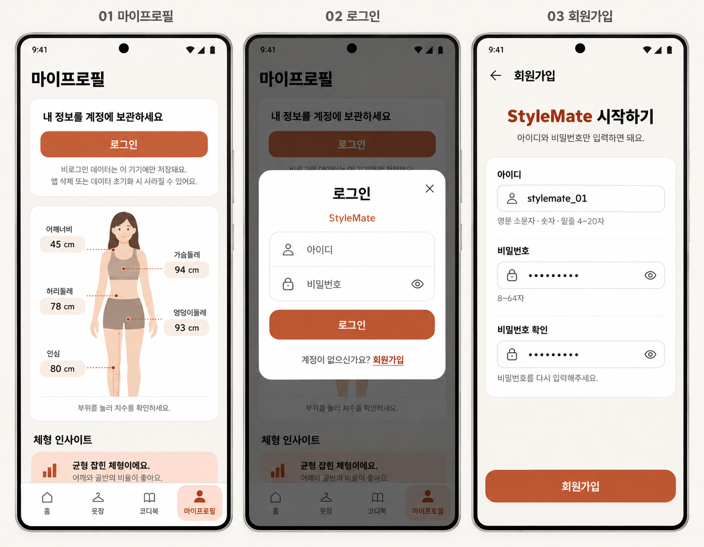

# 로그인 피처 요구사항과 설계

이 문서는 로그인·온보딩 피처의 확정 요구사항과 화면 설계를 정리한다. 구현 브랜치는 `feature/login`이며, 서버 인증·프로필 API, 계정별 접근 제한과 앱의 비로그인 로컬 저장은 구현되었다. 로그인 화면·8페이지 온보딩 화면·계정 가져오기는 아직 구현 전이다.

## 인증과 회원가입

- 모바일 앱에서 별도 아이디와 비밀번호로 회원가입·로그인한다. 이메일·이름·전화번호는 받지 않는다.
- 아이디는 영문 소문자·숫자·밑줄 4~20자로 제한하고 중복을 허용하지 않는다.
- 비밀번호는 8~64자로 제한하며 별도 문자 조합을 강제하지 않는다. 회원가입 시 비밀번호 확인이 일치해야 한다.
- 비밀번호는 서버에 해시로 저장한다. 기기나 서버 DB에 원문 비밀번호를 저장하지 않는다.
- 회원가입 성공 시 자동 로그인하고 마이프로필로 돌아간다. 로그인 성공 시에도 마이프로필로 돌아간다.
- 로그인 실패 안내는 `아이디 또는 비밀번호가 올바르지 않습니다.`로 통일한다. 입력 오류와 네트워크 오류는 구분하여 표시한다.
- 앱 종료·재실행 후에도 로그인을 유지한다. 로그아웃 또는 인증 만료 시 로그인 상태를 해제한다.
- 소셜 로그인, 비밀번호 복구, 이메일 인증, 계정 삭제는 이번 범위에서 제외한다.

인증에는 Django의 사용자·비밀번호 해시 기능과 DB 기반 Bearer 토큰을 사용한다. 토큰은 발급 후 30일간 유효하며 로그아웃 시 해당 토큰만 폐기한다. 서버에는 토큰의 SHA-256 해시만 저장하고 원문은 가입·로그인 성공 시 한 번 반환한다. 앱의 안전한 토큰 보관은 앱 연동 단계에서 구현한다.

| API | 요청과 동작 |
| --- | --- |
| `POST /api/auth/register/` | `username`, `password`, `password_confirmation`으로 가입. 201과 함께 토큰·만료 시각·사용자 정보 반환 |
| `POST /api/auth/login/` | `username`, `password`로 로그인. 200과 함께 토큰·만료 시각·사용자 정보 반환 |
| `POST /api/auth/logout/` | 현재 토큰 폐기, 204 반환 |
| `GET /api/users/me/` | 현재 사용자 정보 반환 |
| `PATCH /api/users/me/` | `body_profile`, `preferred_fits`, `preferred_styles`, `favorite_colors` 중 전달한 항목만 수정 |

로그아웃·내 정보와 옷장 DB·코디 API에는 `Authorization: Bearer <token>`이 필요하다. 누락·만료·폐기된 토큰은 401, 다른 계정의 데이터 ID는 404로 처리한다. 로그인 실패는 `INVALID_CREDENTIALS`, 중복 아이디는 `USERNAME_TAKEN`, 비밀번호 확인 불일치는 `PASSWORD_MISMATCH`다. 사용자 정보 응답에는 비밀번호 해시를 포함하지 않는다.

- 같은 아이디로 5분 내 연속 5회 로그인에 실패하면 5번째부터 5분간 429 `LOGIN_LOCKED`를 반환한다. 로그인 성공 시 실패 횟수를 초기화하며 존재하지 않는 아이디도 같은 정책을 적용한다.
- 가입·로그인 요청은 같은 접속 IP에서 합산하여 1분에 20회까지 허용한다. 초과하면 429 `TOO_MANY_REQUESTS`를 반환한다. 두 제한 모두 `Retry-After` 헤더와 `retry_after` 초 단위 값을 제공하며, 카운터는 `AuthRateLimit` 테이블에서 공유한다. IP는 `REMOTE_ADDR` 기준이며 클라이언트가 보낸 전달 헤더는 신뢰하지 않는다. 프록시 배포에서는 실제 접속 주소 전달 구성을 별도 검증해야 한다.
- 인증·프로필 JSON 요청은 최대 8KiB이며 중복 키·비유한 숫자를 거절한다. 프로필 수정은 위 4개 필드만 허용하고 핏은 최대 5개, 무드는 최대 6개, 컬러는 최대 8개로 제한한다.
- 체형 객체는 `height_cm`, `weight_kg`, `gender`, `measurements`, `clothing`, `reference`만 허용한다. 치수는 기존 16종을 중복 없이 저장하며, 양수·유한한 숫자와 기존 체형 범위를 검증한다. 신뢰도·수정 여부·복장·참고 체형의 중첩 필드도 검증하며 사진·임의 필드는 받지 않는다.

사용자 정보는 `id`, `username`, `body_profile`, `preferred_fits`, `preferred_styles`, `favorite_colors`로 구성된다. 핏 코드는 `oversized`, `wide`, `regular`, `tapered`, `slim`, 무드 코드는 `minimal`, `cityboy`, `casual`, `street`, `classic`, `sporty`를 사용한다. 컬러는 중복 없는 대문자 `#RRGGBB` 목록이다. 체형 정보는 현재 앱의 치수·수정 여부 등을 담은 JSON 객체이며 삭제 시 null을 전달한다. 추천 계산에는 이 사용자 취향을 새로 연결하지 않는다.

## 확정 화면 디자인

사용자가 승인한 위 시안에서 로그인 카드·팝업·회원가입의 디자인을 유지한다. 이후 확정한 스타일 프로필 중심의 마이프로필 구성은 아래 온보딩·스타일 프로필 설계를 우선한다. 실제 화면 캡처가 아니라 현재 코드에서 재구성한 컨셉 이미지이며, 기존 체형 그림·데이터 표시는 별도 체형 화면에서 실제 컴포넌트를 재사용한다.

[공통 디자인 기준](../wardrobe/design.md)과 `StyleMateTheme`를 우선한다. 크림 배경 `#F8F6F2`, 흰 카드, 테라코타 강조색 `#C4552B`, 기존 글꼴·여백·둥근 모서리를 유지한다. 네이버 참고 화면에서는 간결한 입력란 묶음과 주요 버튼 구성을 반영한다.

### 마이프로필

- 스타일 프로필 중심의 본문 위에 흰 로그인 카드를 추가한다. 체형·치수 전체 결과는 본문에 직접 펼치지 않고 `체형 밸런스 참고` 카드의 진입점을 통해 별도 화면에서 표시한다.
- 카드에 `내 정보를 계정에 보관하세요`와 로그인 버튼을 배치한다.
- `비로그인 데이터는 이 기기에만 저장돼요. 앱 삭제 또는 데이터 초기화 시 사라질 수 있어요.`를 안내한다.
- 로그인 상태에서는 계정 아이디와 로그아웃 버튼을 표시한다.

### 로그인 팝업

- 마이프로필 위에 배경을 어둡게 하는 중앙 팝업으로 표시한다.
- 아이디·비밀번호 입력란, 비밀번호 표시 전환, 로그인 버튼, 닫기를 제공한다.
- 하단에 `계정이 없으신가요? 회원가입`을 표시하고 회원가입을 링크로 연결한다.
- 비밀번호 찾기·소셜 로그인·패스키 버튼은 표시하지 않는다.

### 회원가입

- 별도 화면에 뒤로 가기와 회원가입 제목을 표시한다.
- 아이디·비밀번호·비밀번호 확인 입력란과 규칙 안내를 배치한다.
- 하단 주요 행동으로 회원가입 버튼을 제공한다.
- 별도 약관 동의 단계나 추가 개인정보 입력은 이번 시안에 포함하지 않는다.

## 현재 저장 구조와 변경 설계

현재 서버는 Django ORM과 MySQL 설정을 사용한다. Django 인증 기반 `User` 모델과 `Garment.user`·`Outfit.user` 외래 키 및 마이그레이션을 추가했다. 기존 연결 모델 `OutfitItem`은 유지한다. 옷·코디의 소유자는 필수이며 API에서 인증된 사용자로 지정한다. 전환 마이그레이션은 승인된 정책대로 소유자 없는 기존 행만 제거하고 소유자가 있는 행은 유지한다. 토큰은 별도 `AuthToken` 테이블에 저장한다. 실제 MySQL 적용은 별도 수행한다.

Android는 `LocalUserStore`를 통해 앱 전용 `filesDir/local-users/guest/data.json`에 체형, 독립된 스타일 프로필, 온보딩 진행·완료 상태, 추천 취향, 옷·코디를 저장한다. 옷 사진은 같은 폴더 아래 `garments/<UUID>.jpg`에 보관한다. 체형 사진은 저장하지 않는다. 메타데이터는 임시 파일을 거쳐 교체하며, 읽기 실패 시 기존 파일을 초기화하지 않고 오류를 표시한다. 기존 SharedPreferences 데이터는 이전하지 않는다.

기존 체형 입력 화면에 진행·숫자 입력 복원을 연결했고, 건너뛰기 완료 상태도 체형 유무와 별개로 유지한다. 새 8페이지 화면은 후속 구현이다. 계정 UUID별 저장 영역을 만들 수 있지만 현재 앱 경로는 비로그인 영역만 사용하며 로그인 전환·가져오기는 미연결이다.

저장된 옷·코디·사진 조회와 저장 여부 변경은 로컬에서 처리한다. 새 의류 분석, 라벨 계산, 코디 계산·피드백 계산은 서버 연결이 필요하며, 비로그인 미리보기 API는 서버 DB와 사진 저장소에 데이터를 남기지 않는다. 옷 편집 선택지는 서버에서 받아 로컬에 캐시한다. 추천 알고리즘은 기존 계산을 유지한다.

| 모델 | 변경 설계 |
| --- | --- |
| `User` | 내부 사용자 ID, 중복 불가 로그인 아이디, 비밀번호 해시, 체형 정보와 스타일 프로필 저장 |
| `Garment` | 기존 옷 정보·치수·라벨에 소유 사용자 외래 키 추가 |
| `Outfit` | 기존 코디 정보에 소유 사용자 외래 키 추가 |
| `OutfitItem` | 기존 코디·옷 외래 키, 부위 `slot`, 설명 `note` 유지 |

- 사용자 테이블에 옷·코디 ID 배열을 저장하지 않는다. 소유 사용자 외래 키로 목록을 조회한다.
- 코디의 옷 ID 배열로 연결 모델을 대체하지 않는다. 기존 `(outfit, slot)` 중복 금지 제약을 유지한다.
- 본인 데이터만 조회·수정·삭제할 수 있도록 서버에서 검증한다. 코디에는 본인 소유의 옷만 연결한다.
- 옷 등록 시 체형·옷 치수로 핏을 계산하고 저장 전에 수정하는 기존 흐름과 연결한다.

## 비로그인 저장과 계정 가져오기

- 비로그인 상태에서도 체형·옷·코디를 기기에 저장하고 앱 재실행 후 사용할 수 있게 한다. 계정에 연결된 서버 저장은 로그인 후 제공한다.
- 로그인 후 계정 데이터를 불러오고, 가져올 로컬 데이터가 있으면 사용자 동의를 받아 계정에 한 번 추가한다. 지속적인 자동 동기화는 이번 범위에서 제외한다.
- 가져오기를 취소하면 로컬 데이터를 유지하고 마이프로필에서 다시 시작할 수 있게 한다.
- 체형 정보가 양쪽에 있으면 계정 정보를 기본으로 사용하고 로컬 체형으로 교체할지 확인한다.
- 옷·코디도 같은 데이터가 겹치면 교체 여부를 확인한다. 교체하지 않으면 계정 데이터를 유지하고, 겹치지 않는 항목은 추가한다.
- 옷·코디 이름만으로 중복을 판단하지 않는다. 데이터 식별자를 기준으로 재시도 시 중복 저장을 방지한다.
- 옷과 코디 사이의 연결을 유지하며 가져온다. 서버 저장에 실패한 데이터는 로컬에 유지하고 성공이 확인된 항목만 완료 처리한다.
- 로그아웃 후에도 계정 데이터는 서버에 유지하지만 비로그인 화면에 노출하지 않는다. 계정별 데이터와 비로그인 데이터를 분리한다.
- 오프라인에서는 기기에 저장된 정보 조회를 허용한다. 로그인·회원가입은 연결 오류 후 재시도를 제공하며, 서버 저장에 실패하면 입력을 유지하고 재시도를 안내한다.

## 기존 데이터와 구현 우선순위

현재까지 저장된 앱 데이터는 보존할 필요가 없으며, 사용자는 이번 피처에 필요한 초기화·삭제를 허용했다. 기존 데이터의 소유자 복구나 마이그레이션보다 신규 데이터의 정상 동작을 우선한다. 이 허용은 신규 구현 이후 생성되는 사용자 데이터의 자동 삭제 정책이 아니다.

기존 로컬 저장은 충돌이 없으면 활용한다. 신규 DB와 충돌할 경우 기존 로컬 DB를 사용하지 않아도 되며, 호환성 유지만을 위한 불필요한 파일·호환 계층·이중 저장 로직을 추가하지 않는다. 단, 비로그인 로컬 저장이라는 목표 동작은 새 구조에서 충족한다.

관련 구현 지침은 [AGENTS.md](../../AGENTS.md)에 기록한다. 온보딩은 후순위로 두었던 기존 결정을 변경하여 이번 범위에 포함한다. Gemini 채팅을 통한 코디 개선은 유저 플로우에 반영하되 별도 후속 구현으로 다룬다.

## 온보딩과 스타일 프로필

사용자가 제공한 참고 자료는 [온보딩 1~4](onboarding-01-04-reference.png), [온보딩 5~8](onboarding-05-08-reference.png), [스타일 프로필](style-profile-reference.png), [전체 유저 플로우](user-flow-reference.png)다. 참고 이미지에 표시된 네이비 색상보다 기존 공통 디자인 기준을 우선한다. 이미지의 샘플 이름·수치·설정과 외부 서비스의 편집 툴바는 구현 요구사항으로 취급하지 않는다.

### 8페이지 흐름

온보딩 상단바는 뒤로 가기·StyleMate·우측 상단 `건너뛰기` 구성으로 통일한다. 건너뛰기는 우측 상단에만 두고, 하단의 `나중에 선택하기`·`나중에 확인하기`·`나중에 등록하기` 등 중복 행동은 구현하지 않는다. 기존 컨셉 이미지는 수정하지 않고 이 규칙을 우선한다.

| 페이지 | 역할 |
| --- | --- |
| 1 | 환영·서비스 소개. 기존 사용자는 로그인으로 이동 가능 |
| 2 | 선호 핏 복수 선택 |
| 3 | 선호 스타일·무드 복수 선택 |
| 4 | 선택적 체형 분석. 정면·측면 사진과 기본 정보 입력, 나중에 하기 제공 |
| 5 | 체형 분석 결과 확인·수정. 체형 분석을 건너뛰면 이 단계도 건너뜀 |
| 6 | 자주 입는 옷 등록 현황·옷장 구성 |
| 7 | 의류 특징·실측 확인과 등록. 등록할 옷마다 반복하고 등록 현황으로 복귀 |
| 8 | 완료·등록한 옷 요약·첫 코디 추천 진입 |

온보딩에서 수집한 정보는 비로그인 로컬 저장에 연결한다. 로그인은 필수가 아니며 사용자가 원할 때 진행한다. 이후 계정 연결은 기존 가져오기·충돌 시 교체 확인 정책을 적용하고 스타일 프로필도 대상에 포함한다.

체형 분석을 생략해도 선호 정보를 저장할 수 있어야 한다. 현재 `BodyProfile`의 체형 분석 결과에 선호 정보가 묶여 있는 구조를 그대로 온보딩 완료 조건으로 사용하지 않는다. 온보딩 완료 상태는 체형 정보 존재 여부와 구분하여 앱 재실행 후에도 유지한다.

- 핏·무드 선택, 체형 분석, 옷 등록은 모두 건너뛸 수 있다. 옷 5벌은 권장 목표이며 완료 필수 조건이 아니다.
- 중간에 앱을 종료하면 입력과 진행 단계를 저장하고 다음 실행에서 마지막 단계부터 재개한다. 완료 후에는 온보딩을 강제로 다시 표시하지 않고 마이프로필 등에서 수정한다.
- 모두 건너뛰어도 앱에 진입할 수 있다. 체형 정보 없이 추천 화면에 진입하면 기존 체형 분석 필요 안내와 분석 진입 버튼을 표시한다. 체형 정보는 있지만 추천에 필요한 상의·하의가 없으면 옷 등록을 안내한다.

### 마이프로필 구성 변경

- 선호 핏, 선호 무드, 자주 입는 컬러를 스타일 프로필의 주요 정보로 표시한다.
- 선호 핏·무드는 온보딩에서 입력한 내용을 사용하고 마이프로필에서 수정할 수 있게 한다.
- 선호 핏은 복수 선택한 값을 사용자 DB에 저장하고 마이프로필에 모두 표시한다. 선택하지 않으면 레귤러를 기본값으로 사용한다. 비로그인에서는 로컬 저장 후 기존 계정 가져오기 정책을 따른다. 코디 추천에서 이 정보를 사용하도록 변경하는 작업은 이번 범위에 포함하지 않는다.
- `자주 입는 컬러`는 처음에 비워 둔다. 참고 이미지의 예시 컬러를 기본값으로 넣거나 옷장에서 자동 추출하지 않는다. 사용자가 팔레트 관리에서 직접 선택하고 저장한 값만 DB에 보관하고 표시한다. 비로그인에서는 로컬에, 로그인에서는 계정에 연결하여 저장하고 기존 가져오기 정책을 적용한다.
- 체형 정보의 진입점은 참고 이미지 3의 `체형 밸런스 참고` 섹션에 둔다. 해당 카드의 버튼을 누르면 별도 화면에서 기존 체형 분석 결과·치수를 확인한다. 체형 정보가 없으면 같은 진입점에서 분석을 시작할 수 있게 한다.
- 참고 이미지의 이름·이니셜·예시 컬러를 실제 사용자 값으로 고정하지 않는다. 이메일·이름 등 추가 필수 가입 정보를 요구하지 않는다.
- 온보딩 완료 이후 선택적 로그인과 로그인된 계정 표시를 기존 인증 흐름에 연결한다.

### 유저 플로우와 남은 세부 정의

주 흐름은 환영 → 핏 → 스타일 → 선택적 체형 분석·결과 → 옷장 등록 → 첫 코디 추천이다. 추천에서는 날씨·상황·스타일을 반영한 코디를 확인·수정하고, 이후 채팅에서는 자연어 요청으로 코디를 반복 개선한 뒤 확정하는 흐름으로 연결한다.

참고 흐름의 상의 2벌·하의 2벌·신발 1켤레는 옷장 구성 권장 목표다. 신발은 등록을 허용하되, 코디 추천은 기존 상의·하의·아우터 구성을 유지한다. 신발 추천이나 추천 로직 변경은 이번 범위에서 제외한다.

알림 시각·PDF 내보내기·자동 백업 등 참고 화면의 부가 설정은 이번 요청만으로 구현 범위에 추가하지 않는다.

## 완료 기준

- 아이디·비밀번호 규칙, 아이디 중복 및 비밀번호 확인을 검증한다.
- 회원가입·로그인·로그아웃과 앱 재실행 후 로그인 유지가 동작한다.
- 승인된 세 화면과 로그인 상태의 마이프로필을 구현한다.
- 8페이지 온보딩과 단계 간 이동·반복·선택적 체형 분석을 연결한다.
- 체형 분석 없이도 스타일 프로필·온보딩 완료 상태를 로컬에 저장하고 재실행 시 복원한다.
- 자주 입는 컬러는 초기 빈 상태이며 사용자가 저장한 값만 로컬·계정 저장 정책에 따라 보관하고 재실행 시 복원한다.
- 마이프로필은 스타일 프로필 중심으로 표시하고 `체형 밸런스 참고` 카드에서 별도 체형 화면에 진입한다.
- 본인 데이터만 접근할 수 있고 다른 계정의 옷을 코디에 연결할 수 없다.
- 체형·옷·코디 가져오기, 충돌 시 교체 확인, 재시도 시 중복 방지와 연결 보존을 확인한다.
- 가져오기 취소·로그아웃·계정 전환에서 데이터가 섞이지 않는다.
- 네트워크 실패 시 입력과 미전송 데이터가 유실되지 않는다.
- 신규 코드에 맞는 백엔드·Android 테스트와 관련 빌드·린트를 수행한다.
