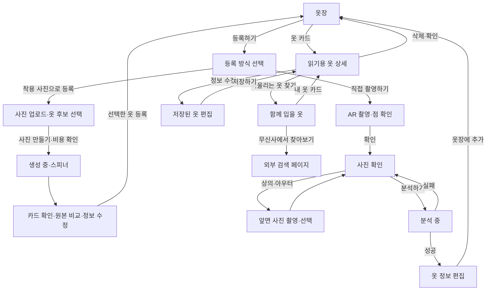

# StyleMate · Wardrobe 화면 설계

수정일: 2026-11-18 · 기준: 현재 Android 구현 및 옷장 메인 디자인 시안

## 1. 범위

공통 앱의 옷장 탭에서 목록·카테고리 필터·AR 촬영·분석·편집·저장·확인 후 삭제를 제공한다. 저장된 옷 카드를 누르면 읽기용 상세를 열고, 그 안에서 정보 수정·어울리는 옷 찾기를 선택한다. 외부 추천은 기존 모델이 예측한 속성을 무신사 검색 링크로 연결한다. 옷장 내 검색, 측정 사진의 갤러리 선택, 상세 종류 프리셋 검색, AI 원본 복원은 제공하지 않는다. 상의·아우터의 앞면 사진만 카메라 또는 갤러리로 받는다.

데이터는 [명세](wardrobe-spec.md), 처리 순서는 [데이터 흐름](wardrobe-flow.md), 종류 선택값은 [코드표](wardrobe-types.md)를 따른다. 원본 PDF는 시각적 참고이며 아래 구현과 다른 화면을 구현 완료로 취급하지 않는다.

## 2. 화면 흐름

- 옷장: 화면 제목은 탭과 같은 `옷장`이다. 전체 개수와 전체·상의·하의·아우터 필터를 표시하며 신발은 기존 등록 항목이 있을 때만 필터에 표시한다. 하단 `등록하기`에서 착용 사진 등록과 직접 촬영을 같은 모양의 카드로 선택한다. 카테고리 필터는 받은 목록에서 수행한다. 조회 오류 시에만 다시 불러오기를 제공한다.
- 외부 추천: 상의는 하의, 하의·아우터는 상의를 예측한다. 별도 결과 화면에서 종류·색상·핏으로 만든 추천명과 실제 내 옷 사진 목록을 표시한다. 결과 옷을 누르면 상세로 이동하며 외부 검색은 별도 버튼으로 제공한다. 실패 시 다시 찾기와 뒤로 가기를 제공하며 신발 상세에는 추천 행동을 표시하지 않고 미지원 안내를 제공한다. 상품 정보는 수집하지 않는다. 계약은 [추천 API](../recommendation/api.md#외부-상품-검색-연결)를 따른다.
- 촬영: 사용자 행동 시 권한 확인 후 ARCore 화면을 연다. 수평 평면 추적 중 촬영하여 사진·평면을 고정하고, 자동 제안점을 확인하거나 직접 수정한다. 최소 한 항목을 측정한 뒤 확인한다. 고정 촬영 높이·기울기 수치·누끼 옵션은 없다.
- 사진 확인: 미리보기·다시 촬영·분석하기를 제공한다. 취소 시 이전 선택을 유지한다. 분석 실패 후 재시도할 수 있으며 수동 입력만으로 새 초안을 생성하지 않는다.
- 앞면 사진: 상의·아우터는 뒷면으로 치수를 재므로, 디자인 분석과 옷장 사진을 위해 앞면을 한 장 더 받는다. 앞면이 있어야 분석할 수 있고, 분석과 저장에는 앞면 사진을 쓴다.
- 편집: 이름·분류·세부 종류·스타일·색상(기본 정보), 해당 옷에 남은 상세 정보(허리선·스커트 형태), 치수, 내 몸 기준 라벨, 메모를 표시한다. 핏은 라벨에서만 고른다. 색상표 또는 사진의 픽셀을 선택해 색상을 추가한다. 한글 라벨은 options 응답으로 표시한다.
- 치수: 소수 둘째 자리까지 표시·수정한다. 신발에는 의류 치수 입력을 표시하지 않는다. 카테고리 변경 시 치수를 초기화하며 종류 변경 시 적용 불가능한 항목을 제거한다. 출처는 데이터로 유지하지만 항목별 AR 추정 문구는 표시하지 않는다.
- 라벨 계산: 계산 중이거나 현재 치수·종류·색상에 대한 계산이 끝나지 않았으면 저장을 막는다. 계산 실패 시에도 수동 라벨 입력란을 유지하며, 재시도에 성공하거나 사용자가 `수동 입력 완료`를 누른 뒤 저장할 수 있다. 재시도는 사용자가 수정한 라벨을 유지한다.
- 저장: 이름은 필수이고 메모는 최대 2,000자다. 저장 중 중복 요청·화면 이탈을 막는다. 성공 시 서버 응답으로 목록을 갱신하고 실패 시 입력값을 유지한다.
- 착용 사진: 본인 착용 사진에서 상의·하의·아우터 후보를 기본 체크한다. 사용자는 필요 없는 옷만 제외하며 선택한 수만큼 생성 비용이 발생함을 확인한다. 생성 후 카드마다 등록 체크 하나, 표시 사진, 자동 제안 핏·기장, 정보 수정·원본과 비교를 제공한다. 원본 비교는 전체 화면에서 원본/완성 사진을 전환한다. 마지막 `선택한 N벌 내 옷장에 등록`이 생성 이미지 승인과 저장을 겸하며 별도 승인 체크는 없다. 핏·기장 미정은 저장을 막지 않는다. 생성 실패·진행 중·옷 이름 없음 등 저장 불가 이유는 문장으로 표시한다. 실패한 옷 제외 또는 착용 원본 사용은 사용자 선택으로 처리한다. 직접 한 벌 지정 기능은 코드에 보관하되 진입 버튼과 안내를 제공하지 않는다.
- 확인 카드: 서비스와 개발 미리보기가 같은 레이아웃을 사용한다. 정사각 이미지 영역을 Crop으로 채우고 사진 안에 원본 비교를 배치한다. 이름·분류·핏·기장·색상·기존 소재 라벨을 표시하며 치수는 접어서 시작한다. 결과 화면에는 사진 추가를 제공하지 않는다. 원본 비교는 전체 이미지가 보이도록 Fit으로 표시한다. 생성·저장 중에는 원형 스피너와 단계 문구를 표시하고 편집·재생성·저장 중복 실행을 막는다.
- 사진 선택: 체형 사진 입력과 같은 흰색·둥근 테두리의 큰 업로드 영역을 눌러 앨범을 연다. 사진 선택 전에는 비활성화된 다음 버튼을 표시하지 않는다.
- 체형 사진 입력: 사진 박스를 누르면 카메라·앨범 선택을 제공한다. 취소하면 기존 사진과 기본 정보를 유지하고, 사진 삭제는 별도 버튼으로 처리한다. `촬영 예시`에서 기존 체형 촬영 가이드를 열고 입력 화면으로 돌아온다. 키보드 여백과 포커스 스크롤로 입력값·오류·분석 버튼에 접근할 수 있다.
- 편집 초안: 로그인한 계정의 탭 상태를 보존하여 탭 왕복 시 옷 항목과 이름·치수·메모·라벨 수정을 유지한다. 저장 성공은 목록으로 복귀하고, 변경 중 뒤로 가기·건너뛰기는 `계속 편집`·`버리기`로 확인한다. 로그아웃·계정 변경 시 편집 화면 상태를 폐기한다. 앱 강제 종료 후 일반 옷 편집 복원까지 보장하지 않는다.
- 촬영 취소: 최초·재촬영 취소는 문구 없이 이전 상태로 돌아간다. 권한·사진 읽기 오류는 복구 안내를 표시하고 새 등록·옷 선택·필터 조작 시 지난 촬영 메시지를 해제한다. 방식 선택 카드에서 상의·아우터의 뒷면 측정 → 앞면 사진 순서를 미리 안내한다.
- 추정 치수: 측정·입력 치수와 별도로 `추정 치수`와 사진·체형 기준 안내를 표시한다. 필드마다 `49–57 cm`처럼 범위 하나만 읽기 전용으로 표시한다. 범위가 없으면 유효한 대표값만 `약 53 cm`로 표시한다. 실측으로 복사하지 않는다. 체형·원본 단서 부족 시 비워두며, 생성 사진을 치수 근거로 사용하지 않는다.

## 3. 공통 디자인 기준 — 앱 전체

옷장 시안에 이어 사용자가 요청한 전체 테마 변경을 적용했다. 로그인·가입·온보딩·홈·옷장·코디북·채팅·프로필·체형 분석·등록·편집·가상피팅·등록 방식 시트·확인창이 하나의 `StyleMateTheme`를 사용한다. 데이터·사진·컬러 팔레트 값과 AR 측정 오버레이는 기능 의미를 유지한다. 기존 [체형 기능 설계](../body-analysis/02-design.md)의 기능·데이터 규칙은 유지하며 시각 기준은 이 절을 따른다.

| 역할 | 공통 구현 기준 |
| --- | --- |
| 화면·카드·시스템 바 받침 | 흰색 `#FFFFFF` |
| 주요 행동·선택·제목 | 검정 `#000000` |
| 보조 글자 | `#5D5D5D` |
| 사진 받침·보조 컨테이너 | `#F5F5F5`, 눌림 받침 `#F4F4F4` |
| 구분선 | 1dp · `#DDDDDD` |
| 오류 글자 / 받침 | `#B3261E` / `#FCEEEE`, 문구와 복구 행동으로 상태 전달 |
| 공통 하단 버튼 비활성 글자 / 받침 | `#666666` / `#ECECEC` |
| 신뢰도 | 높음 `#24603B`, 보통 `#5D5D5D`, 낮음 `#B3261E`; 기존 판단값·라벨 유지 |
| 글꼴 | 플랫폼 기본 글꼴. Pretendard 자산 없음 |
| 화면 제목 | `headlineSmall` 26sp / 700 / 줄 높이 34sp |
| 상단바 제목 | `titleLarge` 22sp / 700 / 줄 높이 30sp |
| 섹션 제목 | `titleMedium` 18sp / 600 / 줄 높이 26sp |
| 본문·입력 | `bodyLarge` 16sp / 400 / 줄 높이 24sp |
| 보조 본문·안내 | `bodyMedium` 14sp / 400 / 줄 높이 20sp |
| 보조 정보 | `bodySmall` 12sp / 400 / 줄 높이 18sp |
| 버튼·필터 | `labelLarge` 14sp / 600 / 줄 높이 20sp |
| 버튼·입력·사진·기본 카드 | 공통 `shapes.medium` 4dp, 그림자 없는 표현 |
| 필터·묶음·모달 | `shapes.large`·`extraLarge` 10dp; 원형 색상 견본과 필수 원형 컨트롤 유지 |
| 채팅 말풍선 | 방향 표시 모서리 2dp, 나머지 4dp; 정렬·보내기·취소 규칙 유지 |
| 공통 하단 행동 | 최소 48dp, 좌우 20dp·상하 12dp, 위쪽 1dp 구분선. 기존 화면의 더 큰 52·56dp 조작 영역 유지 |
| 화면·섹션 여백 | 기존 20dp 화면 여백·4/8/12/16/24dp 계열과 입력 초안·키보드 대응 유지 |
| 하단 내비게이션 | 흰 배경·검정 선택 받침·흰 선택 아이콘·검정 선택 라벨·회색 미선택, 위쪽 1dp 구분선·색상 elevation 없음 |
| 시스템 바 | 흰 화면에 어두운 아이콘. 기기 다크 모드에서도 앱의 밝은 테마 유지; native navigation 속성은 API 27 이상 리소스로 분리 |

색상은 `ui/theme/Theme.kt`의 `StyleMateColors`가 단일 기준이다. 모든 Material 색상 역할과 공통 typography·shapes를 같은 파일에서 정의하며 Material 기본 보라색·기존 테라코타·크림 배경이 다시 노출되지 않도록 했다. `WardrobeStyle`은 공통 팔레트를 참조하는 옷장 배치용 별칭이며 별도 테마를 생성하지 않는다. 의류 사진·무드 이미지·사용자가 고르는 실제 색과 체형 삽화의 피부색은 테마 색으로 치환하지 않는다.

- `ui/components/ScreenComponents.kt`의 `ScreenScaffold`·`PrimaryActionBar`·`SectionTitle`을 체형과 옷장에서 공유한다.
- 옷장 목록은 공통 탭 영역 안에 배치한다. 등록·편집 화면의 상단바는 시스템 여백을 중복 적용하지 않는다. 키보드가 열려도 저장 버튼에 접근할 수 있게 한다.
- `등록하기`, `촬영`, `확인`, `분석하기`, `옷장에 추가`·`저장하기`를 각 단계 하단에 고정한다. 사진 확인의 `다시 촬영`은 체형 결과 화면처럼 상단 보조 행동으로 배치한다.
- 편집 본문은 사진 → 기본 정보 → 상세 정보 → 치수 → 내 몸 기준 라벨 → 메모 순서다. 상세 정보는 접어서 시작하고, 해당 항목이 없으면 표시하지 않는다. 메모가 마지막 입력 항목이다.
- 상세·수정의 추정 치수는 같은 옅은 회색 받침 안에 항목·값을 좌우로 배치한다. 의류 치수의 소수점 둘째 자리 표시는 유지한다.
- 촬영·편집·프로필 선택의 필터는 10dp 모서리와 공통 중립색을 사용한다. 선택 규칙과 데이터 값은 유지하며 옷장 그리드는 3.1을 따른다.
- 상단에는 전체 옷 수만 표시하며 상시 새로고침 버튼은 두지 않는다. 앱 진입 시 서버 목록을 읽고, 저장 성공 시 응답으로 목록을 갱신한다. 조회 실패 시에만 `다시 불러오기`를 제공한다.
- 목록 사진 위에는 삭제 아이콘을 두지 않는다. 상세 헤더 더보기 메뉴의 `삭제`를 누르면 선택한 옷 사진·이름과 관련 코디도 함께 삭제됨을 안내하고 `삭제`·`취소`로 확인한다. `취소`·뒤로 가기·팝업 바깥 터치는 요청을 보내지 않는다. 삭제 중에는 중복 요청과 팝업 닫기를 막고, 실패하면 확인창·상세를 유지하며 재시도를 제공한다. 성공 응답 후 목록·개수·계정 캐시를 갱신한다. 홈·코디북의 삭제 후 무효화 정책은 유지한다.
- 촬영 사진은 정사각 미리보기 안에서 Fit으로 표시한다. 측정점 편집은 기존 사진 종횡비와 좌표계를 유지한다.

- 코디 저장 완료는 홈에서 채운 별과 `저장됨` 라벨, 대화 헤더에서 채운 별과 저장됨 접근성 상태로 표시한다. 홈의 저장 해제와 대화의 중복 저장 방지 규칙은 유지한다. 추천 별점은 읽기 전용 라벨로 구분한다.
- 대화의 옷 유지 선택은 사진 모서리의 열린/닫힌 자물쇠로 표시하며 큰 텍스트 칩을 사용하지 않는다. 터치 영역은 48dp다. 저장·수정 기록은 헤더 우측의 별·버전 기록 아이콘으로 제공한다. 미저장 별은 윤곽선, 저장된 별은 채운 모양과 저장됨 접근성 상태로 구분한다. 큰 글자·좁은 화면의 사진은 카드 너비를 확보하고 가로로 넘긴다.

### 3.1. 옷장 메인 — 흑백·사진 중심 구성

사용자가 제공한 29CM 관찰값을 참고한 **StyleMate 앱 전용 디자인**이다. 최초 옷장 시안에 적용한 뒤 후속 사용자 요청으로 공통 색상·글자·형태를 앱 전체에 확대했다. 팀 전체의 별도 승인 규칙이나 29CM의 공식 모바일 규격을 뜻하지 않는다.

**참고한 요소:** 흰 배경·검정 글자, 사진 중심 정보 위계, 정돈된 정렬, 작은 모서리, 그림자 없는 카드, 제한된 유채색 사용이다. 원본의 데스크톱 제목 크기·작은 상품 글자·할인 색 `#FF4800`은 옮기지 않았다. 가격·할인·구매 UI도 추가하지 않는다.

**StyleMate 결정값:** 공통 토큰은 `ui/theme/Theme.kt`, 옷장 배치는 `ui/wardrobe/WardrobeStyle.kt`·`WardrobeCollection.kt`에 구현한다. 옷장 전용 MaterialTheme 덮어쓰기는 제거했다. 공통 하단 탭·시스템 바·등록·편집·삭제 확인창까지 같은 흑백 테마를 사용하며 인증·서버 API·데이터 모델·추천·초안·ViewModel은 그대로 연결한다.

| 역할 | 실제 적용값 |
| --- | --- |
| 화면·카드·버튼 글자 | `#FFFFFF` |
| 제목·주요 행동·선택 필터 | `#000000` |
| 보조 글자·기본 필터 글자 | `#5D5D5D` |
| 사진 받침·기본 필터 | `#F5F5F5` |
| 구분선·보조 버튼 테두리 | 1dp · `#DDDDDD` |
| 필터 눌림 받침 | `#F4F4F4`, 기본 Material ripple 병행 |
| 키보드로 포커스한 필터 | 2dp · `#375FFF` 외곽선 |
| 오류 글자 / 받침 | `#B3261E` / `#FCEEEE`, 오류 설명과 재시도 행동 병기 |
| 비활성 주요 버튼 글자 / 받침 | `#666666` / `#ECECEC`, disabled semantics 병행 |
| 글꼴 | 플랫폼 기본 글꼴. 저장소에 Pretendard 자산이 없어 추가하지 않음 |
| 화면 제목 | 26sp / 700 / 줄 높이 34sp |
| 상태·섹션 제목 | 18sp / 600 / 줄 높이 26sp |
| 상태 설명 / 인라인 오류 | 16sp / 줄 높이 24sp, 14sp / 줄 높이 20sp |
| 버튼·필터·옷 이름 | 14sp / 600 / 줄 높이 20sp |
| 총 개수·분류·스타일·사진 대체 문구 | 12sp / 400 / 줄 높이 18sp |
| 화면 좌우 / 위아래 여백 | 20dp / 24dp |
| 간격 | 4·8·12·16·24·32dp 계열 중 4·8·12·16·24dp 사용 |
| 카드 / 사진 / 주요·보조 버튼 모서리 | 4dp |
| 필터 모서리 | 10dp |
| 주요·보조 버튼 | 최소 높이 48dp, 주요 버튼 좌우 20dp·상하 12dp 외부 여백 |
| 필터 | 내용 상하 6dp, 시각 높이 기본 32dp, 클릭 영역 최소 48dp. 큰 글자에서는 내용에 맞춰 확장 |
| 옷 관리 | 상세 헤더의 더보기 메뉴에 정보 수정·삭제를 같은 48dp 항목으로 제공. 삭제는 확인창을 거침 |

성공 배너는 이 화면에 새로 만들지 않는다. 기존 저장·삭제 성공 시 목록과 개수가 갱신되는 동작을 유지한다. 성공 전용 색상은 이번 화면에서 사용하지 않는다. `#DDDDDD`는 장식 구분선이며 텍스트나 유일한 선택 상태 표시로 쓰지 않는다.

- **헤더·탐색:** 제목 → 전체 개수 → 가로 스크롤 필터 → 얇은 구분선 → 옷 목록 순서다. 헤더도 목록과 함께 세로로 스크롤해 작은 높이·큰 글자에서 아래 내용을 밀어내지 않는다. 선택은 검정 받침·흰 라벨과 selected semantics로 표시한다. 필터 코드와 단일 선택 규칙, 전체 개수 계산은 유지한다.
- **그리드:** 가용 너비 300dp 이상·600dp 미만에서는 기본 2열, 600dp 이상에서는 3열이다. 가용 너비 300dp 미만 또는 글자 배율 1.6 이상인 600dp 미만 영역은 1열이다. 열 간격 12dp·행 간격 24dp다. 화면 전체 너비가 아니라 실제 가용 너비와 글자 배율로 결정한다.
- **사진:** 모든 입력 사진을 1:1 받침 안에 12dp 여백과 `ContentScale.Fit`으로 표시한다. 세로·가로·투명 사진 모두 옷 전체를 보존한다. 네트워크 사진도 기존 Bearer 인증 로더를 사용하며 목록에서만 이중 사진 프레임을 생략한다. 사진 로딩은 중립색 진행 표시, 없음·읽기 실패는 같은 크기의 대체 문구로 표시한다.
- **정보:** 이름은 사진 아래 12dp에 두며 2줄을 항상 확보하고 넘치면 말줄임한다. 접근성 텍스트에는 원문 이름이 유지된다. 아래에는 분류와 제공된 스타일을 `·`로 연결해 최대 1줄로 표시한다. 사진·정보를 포함한 카드 전체로 기존 선택 메뉴를 연다. 반복되는 카드 테두리·그림자는 없다.
- **하단 행동:** `+ 등록하기`는 검정 48dp 이상 버튼으로 고정한다. 촬영 중에는 기존 `촬영 중` 문구와 중복 실행 방지를 유지한다. 새 방식 선택이나 등록 흐름은 추가하지 않는다.
- **상태:** 최초 로딩·최초 조회 실패를 빈 옷장으로 표시하지 않는다. 조회 전에는 확정되지 않은 0벌도 숨긴다. 빈 옷장·선택 카테고리만 빈 상태를 구분하고 등록 행동을 유지한다. 기존 옷이 있는 조회 실패는 목록을 유지하며 오류·재시도를 표시한다. 기존 재시도 콜백이 있는 경우에만 버튼을 제공하고 로딩 중 비활성화한다. 상태·오류 안내에는 polite live region을 사용한다.
- **시스템 여백:** 서비스에서는 상위 `MainTabs` Scaffold가 시스템 바와 공통 내비게이션 여백을 처리한다. 옷장 내부 Scaffold는 `WindowInsets(0)`을 유지해 여백 중복을 피한다. 하단 버튼은 글자 크기에 따라 높이가 늘어나고 목록은 남은 영역에서 스크롤한다.

### 3.2. 코디북 — 슬라이드·목록 전환

- 제목 아래 `슬라이드`·`목록` 단일 선택 버튼을 배치한다. 처음에는 슬라이드로 열고 계정별 탭 복귀 시 마지막 보기 방식과 코디 선택을 유지한다. 목록의 카드를 누르면 해당 코디의 슬라이드로 전환한다. 조회 갱신·정렬 변경은 선택한 코디 ID를 우선 보존하고, 해당 코디를 뺐을 때는 가까운 코디를 표시한다.
- 사진은 홈과 공용 `OutfitBoard`를 사용한다. 아우터 옆에 상의·하의를 배치하며, 아우터가 없는 두 벌은 좌우로 표시한다. 슬라이드는 큰 사진·점 인디케이터·이름·피팅 행동으로 구성하고, 목록은 작은 동일 배치 사진·이름·크게 보기로 구성한다. 날짜·상시 별 아이콘·반복되는 큰 피팅 버튼은 목록에 두지 않는다. 별도 상세 화면과 대화 수정 진입은 추가하지 않는다.
- 이 기기의 계정별 작업·결과 파일을 확인해 `가상 피팅`·`피팅 생성 중`·`피팅 결과 보기`·`피팅 다시 확인`을 표시한다. 생성·진행·기존 결과는 기존 피팅 화면으로 연결하며 보기 전환은 생성 요청을 보내지 않는다.
- `코디북에서 빼기`는 슬라이드의 보조 행동이다. 선택한 코디 사진·이름과 옷장은 유지됨을 확인창에 표시한다. 취소는 저장을 변경하지 않는다. 처리 중 중복 입력·확인창 닫기를 막고 실패는 확인창에서 재시도한다. 목록 조회 오류와 저장 해제 오류는 분리한다.

### 3.3. MY — 요약과 편집 분리

- 네 번째 탭과 메인 제목은 `MY`다. 메인은 내 체형 정보 → 나의 취향(핏·무드) → 컬러 기록 → 캘린더 스위치 → 계정 설정 순서다. 요약은 카드 테두리 없이 구분선이 있는 행으로 표시한다. 핏·무드는 하나의 편집 화면에서 같은 선택 컴포넌트를 사용하며, 계정 아이디와 로그아웃은 계정 설정 안에 둔다. 로그아웃은 확인을 거친다. 대상이 있을 때 기존 데이터 가져오기는 MY 하단에 둔다.
- 핏·무드·컬러는 공통 상단바와 하단 `저장하기`를 사용한다. 선택만으로 서버 값은 바뀌지 않으며 변경이 있을 때만 저장할 수 있다. 변경 후 뒤로 가면 `계속 수정`·`버리기`를 제공한다. 저장 중 중복 저장·뒤로 가기를 막고, 실패하면 선택과 오류를 보존해 다시 저장할 수 있다. 계정 ViewModelStore에서 초안·저장을 관리하므로 탭 이동이 저장을 취소하지 않는다. 로그아웃·계정 전환은 기존 계정 하위 상태 폐기 계약을 따른다.
- 대표 핏 선택은 기존 `preferred_fits`의 첫 값만 재배치하고 나머지 저장 값은 보존한다. 기존 홈 추천 변환(오버핏·와이드 → 넉넉한 핏, 슬림·테이퍼드 → 슬림한 핏, 레귤러 → 레귤러핏)은 유지하며 편집 화면에서 실제 적용 범위를 안내한다. 무드는 다중 선택·전체 해제, 컬러는 최대 8개·전체 해제를 지원한다. 컬러 기록은 현재 추천에 사용되지 않는다는 점을 편집 위치에 표시한다.
- `소셜 연동`은 `캘린더 연동`으로 정리하고 MY 안에서 연결 스위치를 바로 조작한다. 권한 거부 복구와 연결 해제를 유지하며 설정·OS 권한 변경 후 요약의 연결 상태를 갱신한다.
- 체형 상세는 공통 뒤로 가기와 키·몸무게 요약 → 온보딩 예시 모델 위 치수 → 인사이트·치수 목록 → 재분석 → 보조 삭제 순서다. 예시 모델은 사용자 체형 재현이 아님을 표시한다. 추정값 안내와 기존 삭제 확인·실패 처리를 유지한다. 이번 변경은 컬러 추천 반영·체형 치수 직접 수정·추천 계산·API 계약을 확장하지 않는다.

## 4. 미구현 범위

옷장 내 검색·측정 사진 갤러리·상세 프리셋·분석 실패 후 수동 신규 등록·S3는 현재 제공하지 않는다. 미구현 기능의 버튼이나 API 계약을 현재 동작으로 문서화하지 않는다. 체형·추천·공통 탭의 기능 범위는 해당 담당 문서를 따른다.

## 5. 유지 기준

UI 문구는 촬영하기·암홀·소매끝처럼 짧게 작성한다. 구현 설명은 문서에 두고 화면에는 현재 행동에 필요한 안내만 둔다. 기능 변경 시 이 문서와 데이터 명세·흐름·architecture를 실제 코드에 맞춰 갱신한다.

## 6. 1차 옷장 시안 검증 기록 (2026-11-18)

아래는 전체 테마 확대 이전의 옷장 시안 검증 기록이다. 앱 전체 적용과 추가 검증은 7절을 따른다.

### 시각 비교 방법

기존 `Medium_Phone` 에뮬레이터에서 서비스의 `WardrobeScreen`을 직접 렌더링했다. 전후 모두 1080×2400px, 같은 6벌·이름·분류·스타일·샘플 이미지다. 원본 계정·사진·운영 DB는 사용하지 않았다. 의상 그림은 테스트 Canvas로 만든 합성 자료이며 실제 상품 사진이나 AI 분석 결과가 아니다. 이 비교는 옷장 컴포저블 영역이며 공통 하단 내비게이션·시스템 바까지 포함한 운영 계정 화면 캡처는 아니다.

작은 화면은 320×568dp, 기본 글자와 200% 글자 배율에서 각각 검사한다. 시스템 글자 설정은 변경하지 않고 테스트의 LocalDensity로 제한한다. 사진은 세로·가로·투명 배경과 사진 없음, 이름은 긴 이름까지 포함한다. 실제 사진 디코딩·운영 이미지 서버 성능은 별도 실기기 확인 대상이다.

| 검증 | 결과 |
| --- | --- |
| `assembleDebug`, `assembleDebugAndroidTest` | 통과. 기존 Android 프로젝트·라이브러리만 사용 |
| `testDebugUnitTest` | 318개 통과, 실패·건너뜀 없음 |
| `lintDebug` | 오류 0개, 경고 37개·힌트 1개. 새 시각 컴포넌트의 진단 없음 |
| Django `apps.users apps.wardrobe apps.outfits --settings=config.test_settings --noinput` | 격리 DB에서 219개 통과 |
| 옷장 UI·등록·편집 | `WardrobeRedesignTest` 8개, `WardrobeScreenTest` 8개, `GarmentEditorTest` 3개, `wardrobeOffersBothRegistrationPaths` 1개 통과 |
| 인증·UX 보존 | `AppNavigationTest` 5개, `AuthenticationFlowTest` 2개, `UxPhaseOneTest` 편집·계정 경계 2개 통과 |
| UI 합계 | 서로 다른 29개 통과. 20개·17개로 나누어 실행했으며 디자인 8개는 작은 화면 높이를 568dp로 제한한 뒤 재검증 |
| 문서·변경 보존 | 문서 링크·구조·`git diff --check` 확인. `WardrobeRoute`와 등록 방식 설명은 시작 시점과 일치 |

로딩·최초 오류·기존 목록을 유지한 오류·필터 선택·빈 옷장·320×568dp·200% 글자·긴 이름을 확인했다.

최초 UI 검사에서 새 분류 라벨과 필터의 동일 문구로 테스트 대상이 중복되고, 화면 밖 LazyGrid 항목을 직접 찾는 검사 두 곳이 실패했다. 필터는 선택 가능 semantics로 구분하고 화면 밖 항목은 그리드를 스크롤해 찾도록 고친 뒤 통과했다. 실제 AR 측정·실기기 카메라·유료 생성·운영 서버를 통한 사진 로딩·전체 시스템 바 조합은 이번 작업에서 미검증이다. 백엔드 코드는 변경하지 않았으며 전체 pytest는 이번 디자인 작업에서 재실행하지 않았다.

### 색 대비

텍스트와 실제 불투명 받침의 상대 휘도로 계산했다. 사진 위 삭제 아이콘에도 불투명 흰 받침을 두어 사진 색에 따른 대비 변화를 피한다. 기본 상태의 대비이며 TalkBack 음성 청취·하드웨어 키보드 포커스 순회는 미검증이다.

| 조합 | 대비 |
| --- | --- |
| 흰 글자 / 검정 주요 버튼·선택 필터 | 21.00:1 |
| `#5D5D5D` / 흰 화면 | 6.58:1 |
| `#5D5D5D` / `#F5F5F5` 기본 필터 | 6.04:1 |
| `#5D5D5D` / `#F4F4F4` 눌림 필터 | 5.99:1 |
| `#666666` / `#ECECEC` 비활성 주요 버튼 | 4.86:1 |
| `#B3261E` / `#FCEEEE` 인라인 오류 | 5.79:1 |
| `#375FFF` 포커스 선 / 흰 화면 | 4.95:1 |

### 별도 UX 기록

| 관찰 | 이번 처리·후속 범위 |
| --- | --- |
| 기존 화면은 처음 로딩·조회 실패에서도 빈 옷장 안내를 함께 표시함 | 이번 표시 분기에서 로딩·오류·실제 빈 상태를 구분. ViewModel 상태와 요청·재시도 정책은 유지 |
| 사진 한 장을 불러오지 못했을 때 카드별 재시도 행동이 없음 | 기존 사진 로더와 실패 대체 문구 유지. 이미지별 재시도·캐시 정책은 후속 UX 검토로 남김 |
| 목록 카드 선택 메뉴·등록·편집·공통 내비게이션은 기존 디자인임 | 대표 화면 한정 시안이므로 일괄 변경하지 않음. 다음 단계에서 인접 흐름과 함께 검토 |

1차 옷장 시안에서 다른 UX 작업과 겹친 파일은 `WardrobeScreen.kt`, `design.md`, `architecture.md`다. 기존 저장 후 라벨 초기화, 취소 메시지 정리, `onInteraction`, 버리기 확인 연결, 등록 방식 설명을 보존했다. `WardrobeRoute`와 등록 방식 시트 내용은 작업 시작 시점 파일과 대조했다. 새 시각 컴포넌트와 토큰은 별도 파일에 두었으며 `StyleMateApp.kt`, `GarmentEditor.kt`, `GarmentLabels.kt` 및 다른 화면의 UX 변경은 당시 작업에서 수정하지 않았다.

### 옷 상세·수정·추천의 위계

- 화면의 주요 행동은 하단 고정 버튼 한 개로 둔다. 상세에서는 `함께 입을 옷 찾기`, 수정에서는 `저장하기`다. 정보 수정·삭제처럼 같은 대상을 관리하는 행동은 헤더 더보기 메뉴 안의 동일한 항목으로 묶는다. 삭제는 의미를 알리는 오류색과 별도 확인창을 사용하되 주 버튼으로 강조하지 않는다. 이후 다른 화면에서도 주요 행동·관리 행동·외부 이동을 이 기준으로 구분한다.
- 상세와 수정은 사진 → 기본 정보 → 옷 특징 → 측정/추정 치수 → 메모 순서를 공유한다. 사진 높이는 영역 너비의 72%, 최소 160dp·최대 220dp이며 Fit 표시를 유지한다. 좌우 20dp·섹션 간격 24dp, 사진·구획 모서리 4dp, 회색 `#F5F5F5` 받침·14sp 본문·18sp 구획 제목을 함께 쓴다. 수정에서는 같은 위치의 정보가 입력·선택 필드가 되며 초안·분류별 치수·라벨 계산·저장 규칙은 유지한다.
- 사진 컨테이너 왼쪽 위에 출처를 `AI 이미지`·`착용 사진`으로 짧게 표시한다. 누르면 가려진 부분의 부정확성·원본 기반 분석 등의 안내를 읽을 수 있다. 의미를 없애거나 생성 이미지를 원본으로 표시하지 않는다.
- 측정·입력값이 있는 항목에는 추정값을 반복하지 않는다. 유효한 추정 범위를 한 번만 표시하며 서버의 대표값·범위·근거는 변경하지 않는다. 통계적 신뢰구간이나 실제 측정값으로 설명하지 않는다. 추정값을 저장 payload의 dimensions에 복사하지 않는다.
- 추천은 `내 옷장에서 함께 입기`와 실제 내 옷 목록을 먼저 표시한다. 이후 구분선 아래 `새 옷 찾아보기` 영역 안에 `이런 옷과 잘 어울려요`·추천 종류/색상/핏·무신사 버튼을 연속 배치한다. 외부 이동 오류도 이 영역 안에 둔다. 내 옷 카드와 쇼핑 버튼은 각각 독립된 행동이다. 상품 정보는 수집하지 않으며 추천 계산·API는 유지한다.
- 신발은 기존 데이터 코드·수동 등록/보관 경로를 유지한다. 착용 사진 후보·코디 추천은 지원하지 않으므로 빈 신발 필터는 숨긴다. 기존 신발은 필터와 전체 목록에서 접근할 수 있으며 마지막 신발이 없어지면 전체 필터로 복귀한다.
- 목록·상세·추천의 페이지별 스크롤, 저장/삭제 후 갱신, 계정별 초안·버리기 확인을 보존한다. 검증 결과는 [검증 기록](../login/VALIDATION.md)에 기록한다.

위 확대 적용 계획은 후속 사용자 요청으로 7절에서 수행한다. 인증·취향 점수·추천 알고리즘과 입력 초안 보존은 그대로 유지한다.

## 7. 앱 전체 테마 적용 (2026-11-18)

사용자의 후속 요청에 따라 옷장 한정 시안을 앱 전체로 확대했다. 공통 흰 배경·검정 주요 행동·중립 보조색, 26sp 화면 제목·18sp 섹션 제목, 4dp 버튼·카드·입력과 10dp 필터·모달을 적용한다. 하단 탭은 검정 선택 받침·흰 아이콘과 검정 라벨을 사용하며, 네이티브 시작 화면·시스템 바도 밝은 테마로 연결한다. 옷장에만 존재하던 `WardrobeCatalogTheme`는 제거하고 `StyleMateColors`로 통합했다.

기존 사진·선호 색상 팔레트·무드 사진·체형 삽화의 피부색과 AR 측정점의 구분 색상은 유지한다. 신뢰도 높음·보통·낮음의 계산과 문구는 그대로 두고 의미 색상만 공통 초록·회색·오류 빨강으로 조정했다. 서버 주소·인증·API·추천 계산·계정별 저장·초안·등록 흐름은 변경하지 않았다.

같은 작업 폴더에서 진행된 로그인 소개 카드 제거를 보존했다. 다른 창에서 홈 UX 개선을 시작한 것을 확인한 뒤 홈 파일은 추가 수정하지 않았다. 홈의 개별 배치 변경은 해당 UX 작업의 범위이며, 이 절은 전체 테마 검증 시점의 합성 상태를 설명한다. 앱·서버·DB 데이터 삭제나 브랜치·worktree 생성·전환·커밋·푸시는 수행하지 않았다.

### 화면 검증 방법

`GlobalThemeTest`는 실제 `StyleMateApp`의 홈→옷장→코디북→프로필 탭을 이동하며 선택 상태와 등록 방식 시트를 확인한다. 나머지 화면은 동일한 서비스 컴포저블을 합성 값으로 렌더링한다. 서버 계정·실제 사용자 사진·유료 모델을 사용하지 않는다. 검증 중 캡처로 이전 테라코타·크림·살구 강조색의 픽셀이 남는지도 검사하며, 결과 이미지는 저장소에 포함하지 않는다.

### 검증 중 발견한 사항

- `windowLightNavigationBar`는 최소 지원 API 26의 기본 XML에서 사용할 수 없어 API 27 리소스로 분리했다. 최소 SDK 변경이나 린트 억제 없이 처리했다.
- 기존 기록에도 있는 `AuthViewModelTest.refreshSession_server401ExpiresTheDisplayedSession`의 저장소 정리 시점 간헐 실패가 한 차례 재현됐다. 인증 코드와 해당 테스트는 변경하지 않았고 단독·전체 단위 테스트 재실행은 통과했다.
- AR 실기기 촬영, 실제 유료 생성, API 26 실기기 시스템 바는 이번 테마 변경에서 직접 검증하지 않았다. 로컬 서버는 기존 실행 상태·데이터를 유지한다.

### 검증 결과

아래는 테마 검증용 APK 기준이다. 별도 창의 홈 UX 변경이 병행되므로 홈 레이아웃의 후속 검증 결과와 구분한다.

| 검사 | 결과 |
| --- | --- |
| 앱·UI 테스트 APK 빌드 | 성공, 에뮬레이터에 기존 데이터 유지 방식으로 설치 |
| Android 단위 테스트 | 최종 전체 재실행 318개 통과 |
| Android 린트 | 오류 0개, 기존 경고 37개·힌트 1개 |
| Django 인증·옷장·코디 | 격리 DB에서 219개 통과 |
| 실제 앱 탭·전체 테마 캡처 | `GlobalThemeTest` 2개 통과, 합성 상태 화면 11장과 이전 브랜드 색상 부재 확인 |
| 관련 UI 회귀 | 전체 테마 2개와 기존 78개를 실행해 73개 통과·6개 조건부 건너뜀·1개 타임아웃 |
| UI 건너뜀 | 별도 테스트 계정 인수가 필요한 실제 서버 가입 1개, 알림 권한이 전제인 피팅 검사 5개 |
| UI 타임아웃 | `bodyInputKeepsFocusedErrorAndAnalysisActionAboveTheKeyboard`: 키보드 inset 표시 대기. 단독 재실행도 완료되지 않아 해당 키보드 동작은 미검증으로 남김. 진단 중 변경한 에뮬레이터 키보드 설정은 원래 값으로 복원 |
| 정적·문서 확인 | 이전 브랜드 팔레트 소스 검색, 공통 테마 단일화, 옷장 인증·초안 route 보존, 로컬 문서 링크·공백 검사 통과 |

테마 확대 과정의 기능 코드는 유지했고, 발견한 키보드 검사 한 건은 통과로 처리하지 않았다. 이후 홈 UX 작업과 에뮬레이터 검증을 함께 정리할 때 이 항목을 분리해 다시 확인한다.

## 8. 화면 위계·선택·로딩 보완 (2026-11-19)

- 온보딩: 기존 확정 체형·취향이나 초기 조회에서 확인한 등록 옷이 있으면 반복 진입하지 않는다. 신규 기본값만으로 건너뛰지 않고 진행 중 취향·옷 편집 초안을 유지한다. 마지막 진행 바의 stop indicator는 그리지 않는다. 촬영 예시는 흰 배경의 정면·측면 전신 이미지로 교체하고 설명과 입력 복귀는 유지한다. `촬영 예시`는 48dp 테두리 버튼이며 전신 사진 제목/힌트는 동일 텍스트 기준선으로 정렬한다. 완료 화면은 32dp 체크 아이콘·제목·단일 요약 카드로 구성한다.
- 예시 이미지: `body_capture_guide.png`는 imagegen으로 만든 가상의 성인 정면·측면 촬영 참고 이미지다. 실사용자 사진이나 실제 측정·정확도 결과를 뜻하지 않는다. 앱이 사용하는 이미지 파일은 저장소 안에 포함한다.
- 옷장: 분석·등록을 하단의 같은 행동 행에 4:6 너비로 배치한다. 분석은 흰 테두리, 등록은 검정이며 각각 52dp 이상이다. 헤더 아래 분석 버튼은 제거한다. 등록 방식 두 카드는 회색 받침·1dp 테두리·48dp 이상 조작 영역으로 표시한다.
- 사진 등록: 사람 0명인 옷 사진도 기존 상의/하의/아우터 후보 규칙으로 감지하며 2명 이상은 계속 거절한다. 사람이 없으면 착용 관찰값을 버려 체형·핏·기장 추정을 만들지 않는다. 인식·생성·저장 중에는 화면 전체를 막는 단일 진행 다이얼로그만 스피너를 표시한다. 카드별·하단 버튼의 중복 스피너는 제거한다. API·저장 계약·생성 비용 확인은 유지한다.
- 대화: 저장·수정 기록은 헤더 우측의 별·버전 기록 아이콘, 옷 유지 선택은 사진 위 열린/닫힌 자물쇠다. 선택을 이유로 사진이나 큰 버튼 받침을 채우지 않는다. 키보드가 열리거나 화면 높이에 비해 글자가 크면 사진을 접어 시작한다. 사진은 입력 포커스를 유지하며 펼치고 접을 수 있고, 펼친 영역의 높이를 제한해 대화·입력창 접근을 유지한다. 보낸 메시지는 검정/흰색, 받은 메시지는 회색/검정으로 구분한다. 평가 엄지는 선택 검정·미선택 #8A8A8A이며 원형 선택 배경을 채우지 않는다.
- 코디북: 슬라이드/목록은 작은 벡터 아이콘, 저장 해제는 사진 위 흰 받침의 채운 별이다. 페이지 표시는 코디 수와 무관하게 이전·번호/전체·다음 3개 영역으로 제한한다. 기존 저장 해제 확인과 실제 피팅 상태·실행 연결은 유지한다.
- 상세·수정: 색상도 구분선과 항목/값의 1:2 정렬을 사용한다. 사진 출처 배지는 사진 컨테이너 왼쪽 위에 두고 누르면 설명을 연다. 기본 속성과 계절·핏·무늬 등은 같은 48dp 테두리 필드→스크롤 가능한 선택 시트를 사용한다. 단일 선택은 라디오·즉시 닫기, 다중 선택은 체크박스·기존 최대 개수·완료 버튼이다. 표시명과 저장 코드의 대응·초안·저장 검증은 유지한다.
- 홈: 추천 별점은 코디 사진과 인디케이터 아래의 별도 읽기 전용 행에 둔다. 이유는 18sp 제목 아래 12sp 분류·14sp 본문·12dp 간격과 구분선으로 정렬하며 이유 문장을 제목과 경쟁하는 크기로 키우지 않는다.

체형 분석 엔진·실행 환경 복구는 사용자 중단 요청에 따라 범위에서 제외한다. 사진 후보 감지 변경은 옷 등록 기능에만 적용한다. 가상 데이터 검사와 실제 AI 사진 판정 검증은 구분한다.

## 9. 공통 제목·MY 정리 (2026-11-19)

- 탭 제목은 `PageHeader`에서 26sp/700·줄 높이 34sp, 좌우 20dp·상하 16dp를 사용한다. 뒤로 가기가 있는 하위 페이지는 20sp/600·줄 높이 28sp·상하 8dp로 구분하며 제목과 행동을 세로 중앙에 맞춘다. 제목/부제 간격은 4dp다. 부모가 20dp를 주는 탭 목록에서는 헤더의 수평 여백을 중복 적용하지 않는다.
- 하위 페이지의 뒤로 가기는 24dp 아이콘·48dp 조작 영역을 유지한다. 헤더 시작 여백을 8dp로 두어 실제 화살표의 왼쪽 끝이 본문과 같은 20dp에 오도록 한다. 헤더 전체 높이는 최소 64dp이며 큰 글자·긴 제목에서는 늘어난다. 오른쪽 여백은 20dp다.
- 컬러 편집은 기본색·베이지/브라운·블루/그린·포인트 컬러의 29색을 이름과 함께 표시하며, 기존 12색 HEX와 최대 8개·전체 해제·기존 사용자 컬러를 보존한다.
- 대화 옷 카드는 좌우 8dp·상하 6dp·사진/이름 간격 6dp다. 변경 배지는 사진 왼쪽 아래에 겹쳐 표시하고 배지가 없는 카드에 빈 행을 두지 않는다. 88dp 사진·두 줄 이름 영역·48dp 자물쇠 조작과 큰 글자에서의 사진 영역 스크롤을 유지한다. 수정 기록·저장은 헤더 우측의 48dp 아이콘 버튼으로 제공한다. 옷 상세의 사진 출처 배지는 글자 주변 8dp/3dp로 줄이고 조작 영역은 48dp를 유지한다.
