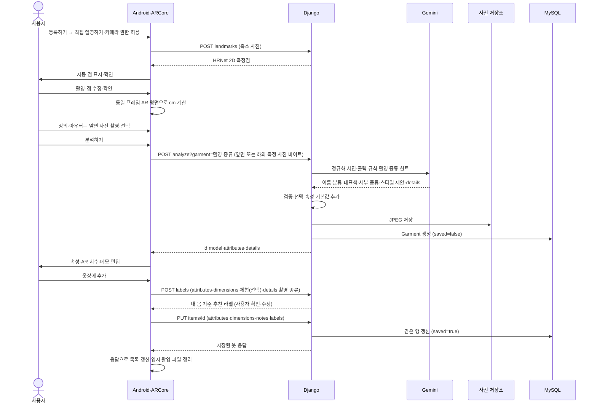

# 옷장 데이터 흐름

수정일: 2026-10-16 · 기준: 현재 구현

## 1. 역할과 저장 위치

| 구성요소 | 역할 |
| --- | --- |
| Android | 카메라 권한, AR 촬영·cm 계산, 점 확인·수정, 사진 픽셀 색상 선택, 편집·저장 요청 |
| Django | 이미지·JSON 검증, HRNet 추론, Gemini 호출, 초안·옷 조회·수정 |
| Gemini | 이름·상위 분류·대표색 1~2개 생성 |
| MySQL | 단일 Garment 테이블에 속성·치수·메모·사진 경로·저장 상태 관리 |
| 서버 파일 저장소 | 정규화 JPEG 보관. 배포에서는 사진 영구 볼륨 필요 |

Android는 로그인 후 계정별 API로 옷을 분석·저장·조회한다. `POST analyze/`는 계정 소유의 서버 초안과 사진을 만들고 편집 확정 시 같은 ID를 갱신한다. 목록·프로필·편집 선택지는 계정별로 캐시하며, 온보딩 진행과 편집 초안도 계정별로 보관한다. 추천은 본인 계정의 저장된 옷을 사용한다. API 키는 서버에만 둔다.

아래 등록 시퀀스는 로그인한 Android의 계정 API 기준이다. 분석·측정점·라벨·사진을 포함해 토큰을 전달하고, 로그아웃·만료 시 로그인 화면으로 돌아간다. 게스트 사용 경로·미리보기 API는 제거했다. 기존 스냅샷을 계정으로 가져오는 인증 기능은 유지한다. 기존 사용자 데이터는 이번 변경에서 삭제하지 않는다. 자세한 계약은 [로그인 문서](../login/README.md)를 따른다.

## 2. 계정용 서버 API 등록·저장 순서

착용 사진 등록은 `본인 사진 선택 → 원본에서 옷 후보·특징·착용 핏/기장 관찰 → 등록할 후보 체크 → 선택 수와 생성 비용 안내 확인 → 계정 체형으로 참고 치수 계산·초안 준비 → 옷별 분리·펼침 생성 → 선택 유지·완성 사진 확인·필요한 정보만 수정 → 함께 등록/승인` 순서다. 핏·기장은 모르면 비워두며 입력을 강제하지 않는다. 한 사람의 옷을 최대 세 벌 지원한다. 상의·아우터는 각 한 벌이며, 하의는 구분 가능한 치마와 바지를 각각 선택할 수 있다. 직접 사각형을 지정하는 코드는 보관하지만 앱에서는 진입 버튼을 숨긴다. 후보를 식별하지 못하면 다른 착용 사진을 선택한다.

생성은 선택한 수만큼 순차 호출한다. 한 벌 실패가 다른 벌의 결과를 지우지 않으며, 할당량·크레딧·설정 오류나 불명확한 네트워크 실패 시 남은 자동 호출을 중단한다. 실패한 옷 제외나 원본 영역 사용은 명시적으로 선택한다. 결과 조회는 추가 생성하지 않는다. 마지막 등록은 포함한 모든 옷의 이미지 선택·정보 형식을 검증해 한 트랜잭션으로 처리한다. 원본 분석과 같은 요청에서 착용 관찰을 받아 치수 추정 때문에 외부 API를 추가 호출하지 않는다. 실측값은 NULL, 추정 치수는 별도 컬럼에 저장하며 추천의 실측 기반 사이즈 판정으로 전달하지 않는다. 상세 계약은 [명세](wardrobe-spec.md)를 따른다. 아래 시퀀스는 기존 AR 등록 경로다.

앱 진입 시 GET options와 GET items로 편집 기준·저장 목록을 읽는다. 목록은 saved=true만 포함하고, 카드 선택 시 정보 수정·어울리는 옷 찾기 메뉴를 표시한다. 정보 수정은 기존 편집 화면으로 연결하며 동일 PUT으로 저장한다. 사진은 GET items/id/image로 읽는다. 카드 우상단 삭제 → `예` 확인 → `DELETE items/id/` 순서로 의상과 해당 의상이 포함된 코디를 삭제한다. `아니요`는 요청하지 않는다. 성공 후에만 목록·개수·계정 캐시를 갱신하고, 실패하면 확인창과 의상을 유지한다.

어울리는 옷 찾기는 선택한 옷 ID로 POST /api/outfits/match-external/을 호출한다. 서버가 기존 모델로 상대 옷의 속성과 검색 URL을 반환하면 팝업에 추천명·근거·바로가기를 표시한다. 외부 페이지는 사용자가 바로가기를 누를 때만 열며, 요청 실패 시 재시도할 수 있다. 상세 계약은 [추천 API](../recommendation/api.md#외부-상품-검색-연결)를 따른다.

## 3. 촬영·측정

촬영 버튼을 누를 때 카메라 권한을 확인한다. 거부 시 설명·설정 이동을 제공하며 목록 접근은 유지한다. 치수 촬영은 앱 내부 ARCore 카메라를 사용하며 갤러리 선택은 없다. 상의·아우터는 측정 후 앞면 사진을 시스템 카메라나 갤러리로 한 장 더 받는다. 측정 화면에서 고른 종류(반팔·긴팔·바지·반바지·스커트)는 분석 힌트와 하의 세부 종류 기본값으로 넘긴다.

HRNet은 원본 사진의 2D 측정점 경로를 반환한다. Android는 사진·카메라 행렬·수평 평면을 같은 프레임에서 고정하고 경로의 점들을 AR 평면에 투영하여 구간 길이를 합산한다. 고정 높이와 기준 물체는 사용하지 않는다. 옷이 바닥 평면과 같다는 가정이므로 실제 치수 정확도는 별도 검증 대상이다.

미리보기는 500ms 간격으로 확인하고 동시 한 요청만 보낸다. 1.2초보다 늦거나 종류·화면·카메라 위치가 바뀐 응답은 사용하지 않는다. 통신 실패 후에는 3초 간격으로 재시도한다. 촬영 후 고정 사진에서 재탐지하며, 사용자가 직접 수정한 항목은 자동 결과로 덮어쓰지 않는다. 탐지 실패 시 직접 점을 지정할 수 있다.

측정점·촬영 프레임 메타데이터는 화면 간 전달에만 사용한다. 서버에는 최종 dimensions와 출처만 저장하며 Gemini에는 점을 합성하지 않은 사진을 보낸다. 촬영 종류와 Gemini 분류가 다르면 앱에서 안내한다.

## 4. 분석·편집

분석 요청은 동기 처리다. 서버는 DB 설정을 먼저 확인한 뒤 이미지 검증·Gemini 호출·사진 및 초안 저장을 수행한다. 실패한 분석을 저장하는 별도 상태 모델은 없다. 원본 분석은 OpenRouter의 Gemini 모델을 사용한다. 외부 분석은 프로세스별 기본 두 건까지 처리하고 초과 요청에는 AI_BUSY를 반환한다. CPU 측정점 탐지는 별도 한 건 제한을 유지한다. OpenRouter의 429와 잔액 부족은 각각 AI_RATE_LIMITED와 AI_CREDITS_REQUIRED로 안내하며 자동 재요청하지 않는다.

AI는 name·category·colors를 생성하고 subcategory·styles를 제안한다(분류와 맞지 않거나 허용값 밖이면 null·[]). 무늬·넥라인·옷깃·디테일·겉으로 분명한 소재는 추천 라벨 계산에만 쓰는 details로 따로 돌려준다. 나머지 선택 속성은 null로 초기화하고 사용자가 입력한다. 최초 AI 결과의 별도 복사본이나 표시용 display 응답은 저장·전달하지 않는다. 화면 표시는 options의 한국어 라벨·색상표를 사용한다.

사진 색상 선택은 Android가 화면 좌표를 사진 픽셀에 매핑하여 HEX를 얻는다. 추가 AI 호출 없이 편집값으로 저장한다. 메모는 맨 아래 입력하며 AI에 전송하지 않는다.

AR 치수를 변경하지 않으면 출처·방법을 유지한다. 사용자가 숫자를 바꾸면 user_measured·unspecified·reference=null로 보낸다. 카테고리 변경 시 치수를 초기화하고, 종류 변경 시 적용 불가능한 치수·속성을 제거한다.

## 5. 실패·재시도와 수명

| 상황 | 현재 동작 |
| --- | --- |
| 촬영 취소 | 새 임시 파일 정리, 이전 사진 유지 |
| 점 탐지 실패 | 직접 점 지정 가능 |
| Gemini 분석 실패 | 사진 유지, 재시도·재촬영 가능. 분석 없이 새 옷 저장하는 흐름은 없음 |
| 분석 응답 유실 | 완료된 초안이 남을 수 있음. 분석 재시도는 새 초안을 만들 수 있음 |
| 저장 실패 | 편집값 유지, 같은 ID로 PUT 재시도 |
| 저장 응답 유실 | 같은 ID로 다시 PUT하면 동일 행 갱신. 옷이 추가 생성되지 않음 |
| 목록 조회 실패 | 오류·다시 불러오기 제공 |
| 앱 재실행 | 서버에서 확정 목록 재조회. 미저장 편집 복원은 보장하지 않음 |

앱 촬영 캐시는 24시간을 기준으로 오래된 파일을 정리한다. 확정된 로컬 사진에는 이 캐시 정리를 적용하지 않는다. 의상 삭제는 DB 트랜잭션에서 의상·관련 코디·더 이상 사용하지 않는 착용 원본 기록을 제거한 뒤, 커밋 후 전체 계정의 사진 참조를 확인해 미사용 원본·분할·생성 파일을 정리한다. 다른 의상·미저장 초안이 사용하는 파일은 유지한다. 롤백 시 파일을 유지하며, 파일이 없으면 무시하고 저장소 오류는 로그에 남긴다. 삭제하지 않은 초안의 자동 만료·과거 누적 파일 정리·삭제 실패 자동 재시도는 없다. 사진 저장 후 DB 생성 실패 시 사진 삭제를 시도한다. 사용자별 접근 제어는 구현되었으며 일반 사진 분석 요청의 중복 방지 키·동시 편집 충돌 제어는 미구현이다.

API 필드·한도·오류 코드는 [데이터 명세](wardrobe-spec.md), 실행과 검증 명령은 [실행 안내](local-development.md)를 따른다.
